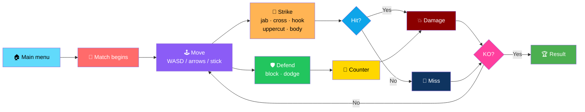
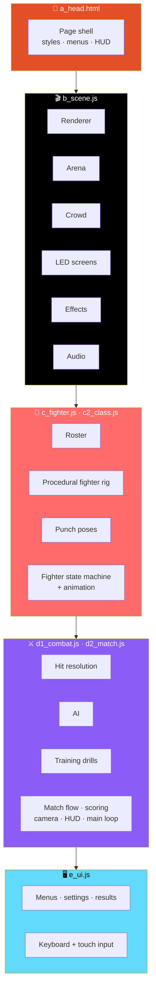

# 🥊 KY vs CHEA — Boxing Championship

<div align="center">


**A 3D boxing game for desktop and mobile browsers.**

*Jab · Cross · Hook · Uppercut · Body punch · Block · Dodge · Special*

[🚀 Run](#-run) • [🎮 Controls](#-controls) • [🏗️ Source Layout](#-source-layout-src) • [🔧 Tuning](#-tuning)

</div>

---

## 📖 Overview

**KY vs CHEA — Boxing Championship** is a **3D boxing game** for **desktop and mobile browsers**.

### Core Idea

> **Real fighting-game depth on the web.**
>
> Jab, cross, hook, uppercut, and body punch — with blocking, dodging, and specials. One player against the AI, or two players head to head.

### The Fight Flow



---

## 🚀 Run

### Option 1 — Just Open It

**Open `index.html`** in a modern browser:

- Chrome · Edge · Firefox · Safari

> ✅ **`three.min.js` sits next to it, so it works offline.**
>
> **Google Fonts load from the web when online; the game falls back to system fonts otherwise.**

### Option 2 — Serve It Locally

```bash
python3 -m http.server 8000
```

Then open **http://localhost:8000**.

---

## 🎮 Controls

### 🥊 Player 1 — Keyboard

<div align="center">

| Key | Action |
|:---:|--------|
| **W A S D** | Move |
| **J** | Jab |
| **K** | Cross |
| **U** | Left Hook |
| **I** | Right Hook |
| **O** | Uppercut |
| **L** | Body Punch |
| **Space** *(hold)* | Block |
| **Q / E** | Dodge left / right |
| **Shift** | Special |
| **P / Esc** | Pause |

</div>

### 🥊 Player 2 *(Versus Mode)* — Keyboard

<div align="center">

| Key | Action |
|:---:|--------|
| **Arrow keys** | Move |
| **Numpad 4/5/7/8/9/6** *(or 1–6)* | Punches |
| **Numpad 0** *(or `/`)* | Block |
| **Numpad 1/3** *(or `,` and `.`)* | Dodge |
| **Numpad Enter** *(or Right Shift)* | Special |

</div>

### 📱 Touch

<div align="center">

| Control | Action |
|:-------:|--------|
| **Left joystick** | Move |
| **Punch buttons** | Strike |
| **BLOCK** | Hold to block |
| **DODGE L / R** | Dodge left or right |
| **SPECIAL** | Special attack |

</div>

### ⬆️ Getting Up

> **When knocked down, mash any punch button to get up faster.**

---

## 🏗️ Source Layout

```
src/
├── a_head.html        page shell · styles · menus · HUD
├── b_scene.js         renderer · arena · crowd · LED screens
│                      effects · audio
├── c_fighter.js       roster · procedural fighter rig · punch poses
├── c2_class.js        Fighter state machine and animation
├── d1_combat.js       hit resolution · AI · training drills
├── d2_match.js        match flow · scoring · camera · HUD · main loop
└── e_ui.js            menus · settings · results
                       keyboard and touch input
```

### Build

> **Edit the files in `src/` and run `./build.sh` to regenerate `index.html`.**

### System Overview



### Design Principles

<div align="center">

| Principle | Implementation |
|-----------|---------------|
| **🎨 Procedural fighters** | **Every fighter is built from Three.js primitives** — **no 3D model files** |
| **🎮 Real fighting-game depth** | **Six punch types, blocking, dodging, and specials** — **not just mash-to-win** |
| **🖥️ Desktop and mobile parity** | **Full keyboard controls** on desktop — **joystick and buttons** on touch |
| **👥 One player or two** | **AI opponent** or **versus mode** on the same keyboard |
| **⚡ No build step to play** | `index.html` **works as-is** — **`build.sh` is only for editing the source** |
| **🌐 Offline-ready** | **`three.min.js` ships next to `index.html`** — **no CDN needed at runtime** |
| **🎯 Tuning is centralized** | **Fighter constructor, ATK table, and `aiStep`** are the three tuning points |

</div>

---

## 🔧 Tuning

> **The three knobs that shape the game's feel.**

<div align="center">

| What to Tune | Where |
|:------------:|-------|
| **Damage · speed · stamina** | **`Fighter` constructor** in `c2_class.js` |
| **Attack table** | **`ATK`** in `c_fighter.js` |
| **AI behavior** | **`aiStep`** in `d1_combat.js` |

</div>

---

## 🗺️ Roadmap

### ✅ Current

- [x] 3D boxing game in Three.js r128
- [x] Works offline with `three.min.js` shipped next to `index.html`
- [x] Google Fonts with system-font fallback
- [x] Runs from `file://` or any static server
- [x] Single-player vs AI mode
- [x] Two-player versus mode on the same keyboard
- [x] Six punch types — jab, cross, left hook, right hook, uppercut, body punch
- [x] Blocking with hold
- [x] Dodge left and right
- [x] Special attack
- [x] Pause with `P` or `Esc`
- [x] Touch controls — left joystick, punch buttons, BLOCK, DODGE L/R, SPECIAL
- [x] Mash to get up when knocked down
- [x] Procedural fighter rig built from Three.js primitives
- [x] Punch pose animations
- [x] Fighter state machine with animation
- [x] Hit resolution system
- [x] AI opponent
- [x] Training drills
- [x] Match flow with scoring
- [x] Dynamic camera
- [x] Arena, crowd, and LED screens
- [x] Visual effects and audio
- [x] Full HUD
- [x] Menus, settings, and results screens
- [x] Keyboard and touch input handled through `e_ui.js`
- [x] Modular source layout under `src/`
- [x] `build.sh` regenerates `index.html` from source
- [x] Centralized tuning points for damage, speed, stamina, attack table, and AI

### 🔜 Future Ideas

- [ ] **Additional fighters** — the roster is data-driven
- [ ] **Additional arenas** beyond the current one
- [ ] **Career mode** — progression across fights
- [ ] **Replay system** — review your best knockouts
- [ ] **Local leaderboards** — per fighter and per difficulty
- [ ] **More special moves** — beyond the current single special
- [ ] **Commentary** — synthesized voice or text
- [ ] **Rounds and titles** — championship progression
- [ ] **Online multiplayer** — would require a real backend or WebRTC
- [ ] **Accessibility options** — colorblind-friendly UI, remappable keys

---

## 🤝 Contributing

Contributions are welcome. Please:

1. Fork the repository
2. **Edit files in `src/`, not `index.html`** — **`index.html` is generated by `./build.sh`**
3. **Keep the module boundaries** — one concern per file
4. **Keep tuning in the documented places** — Fighter constructor, `ATK` table, `aiStep`
5. **Preserve desktop and mobile parity** — every action needs both
6. **Keep fighters procedural** — no model files
7. **Keep it offline-capable** — `three.min.js` must remain next to `index.html`
8. **Test on both desktop and mobile** before submitting
9. Submit a Pull Request

### Guidelines

- **Never edit `index.html` directly** — **regenerate it from `src/`**
- **Never require a CDN at runtime** — the game must work offline
- **Never break one-player or two-player modes**
- **Never remove touch controls**
- **Never add a required external dependency** beyond Three.js
- **Never present a stub as a feature**

---

## 📜 License

MIT — see [LICENSE](LICENSE) for details.

---

## 🙏 Acknowledgments

- **Three.js** — for making procedural 3D fighters possible without assets
- **Every fighting game that ever made you lean into a punch** — this one's for you

---

<div align="center">

### 🥊 JAB. HOOK. UPPERCUT. KO.

**A 3D boxing game for desktop and mobile browsers.**

**Zero build step to play. Full source in `src/`. Offline-ready.**

<br>

> 💡 **When knocked down, mash any punch button to get up faster.**

<br>

⭐ If KY vs CHEA landed a knockout, consider giving it a star.

<br>

[⬆ Back to Top](#️-ky-vs-chea--boxing-championship)

</div>
